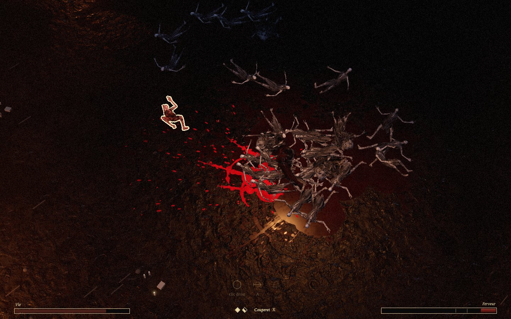
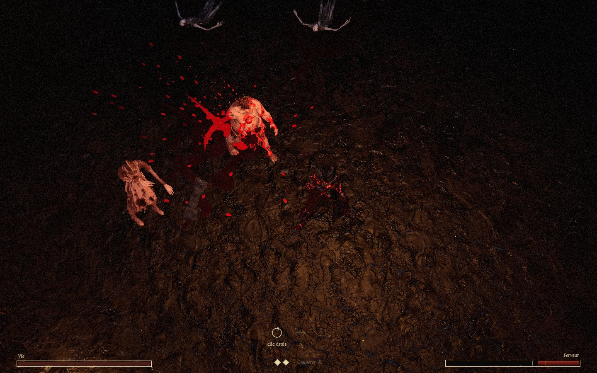
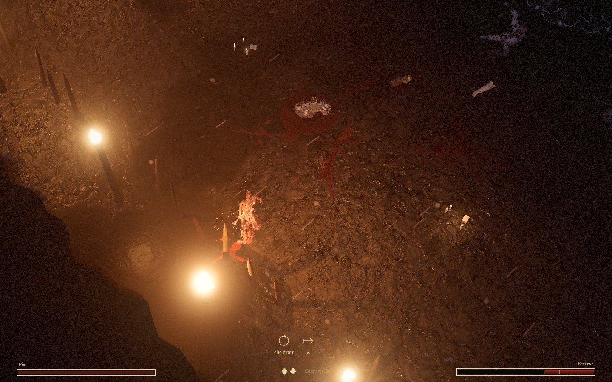
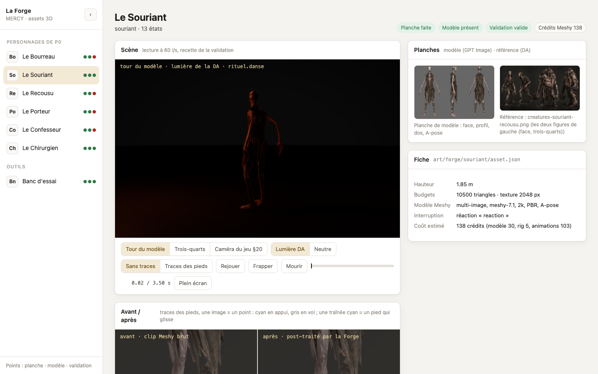
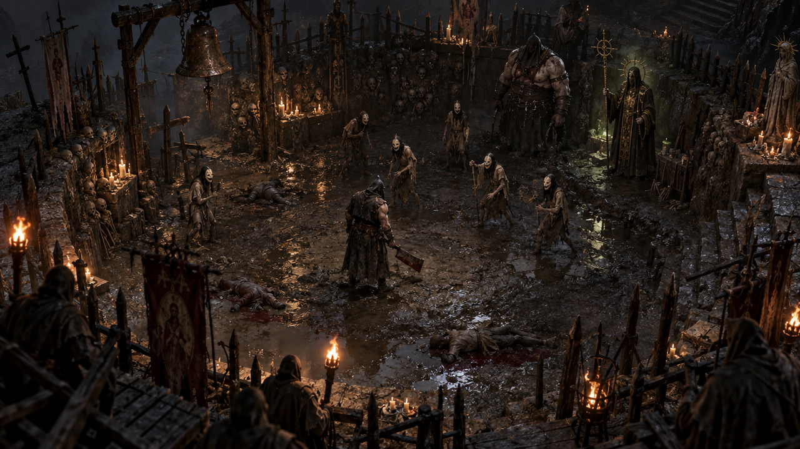

# MERCY

Un ARPG sombre où la mort est une grâce. Les créatures abattues ne meurent pas : elles rampent, crient et se relèvent tant que le Bourreau ne leur donne pas la mort. Le silence d'un cri qui s'éteint est la récompense, le sang la marque de la libération.

Ce dépôt contient le prototype P0, « La Fosse » : une arène, six familles de créatures, les sept lois du monde, et un jeu jouable dans le navigateur avec ses vrais modèles, sa lumière, son sang et son son.

## Aperçu

Fin de la vague 6. Les morts gisent dans le noir, à peine éclairés. Le sang frais, rouge vif, gicle près du Bourreau. Un Abattu encore vivant, à gauche, porte son liseré ivoire.



Caméra proche, vague 3 : un Recousu saigne sous les coups, le Bourreau tient son Couperet.



Vague 5, au bord de la Fosse : torches, pieux, chandelles posées au sol, une flaque sous un corps.



La Forge, l'outil qui fabrique les personnages : une planche générée par GPT Image, un modèle et des animations par Meshy. La Forge les valide par des mesures, avec les clips avant et après ses corrections.



La planche de concept qui fixe la direction artistique (`art/concepts/`, GPT Image) :



Captures du 2026-10-12, à 1440×900 et à la caméra de jeu du §20 sauf mention contraire, jouées par le bot `trieur`.

## Jouer

```sh
pnpm install
pnpm dev            # http://localhost:5741
```

- Paramètres d'URL : `?wave=V1` à `V6`, `&seed=2`, `&variant=A` (B par défaut), `&policy=trieur` pour qu'un bot joue, `&until=900` pour s'arrêter à un tick.
- Contrôles (touches lues par position : ZQSD en AZERTY) : clic gauche **maintenu** pour enchaîner les Frappes, clic droit Balayage, A Charge, Espace Esquive, F Sentence, X changer d'arme, Échap pause, Entrée pour rejouer, `²` pour le panneau de dev (télémétrie exportable et rejouable).
- Autres pages : `forge.html` (galerie des modèles et de leurs animations, avant et après post-traitement), `render-lab.html` (scènes de mesure du rendu), `audio-lab.html` (banc du son).

## Vérifier

```sh
pnpm gates          # types, lint, dépendances, déterminisme, tests, Forge
pnpm build
pnpm bots -- --waves V3 --policies trieur --seeds 1-100 --variants B --latency 12 --out /tmp/bots
```

## Où sont les décisions

- `GAME_SPEC.md` fait foi. Sa dernière section, « Écarts d'implémentation et précisions », date chaque décision prise en route. Les plus lourdes viennent du premier jeu du concepteur : l'agonie à la mort, le sang célébré, la lumière normale, plus aucune zone d'attaque peinte au sol.
- `ART_DIRECTION.md` pour l'image, `MERCY_GDD_v0.1.md` pour le document d'origine.
- `.mercy/` n'est **pas versionné** et n'existe que sur la machine de travail. On y trouve les contrats de comportement B1 à B5 (gelés, avec empreintes), les verdicts des vérificateurs, les briefs et le journal `progress.md`, qui consigne chaque décision avec sa raison. Sans lui, la spec et l'historique git suffisent pour reprendre.

## Règles qui ne se voient pas dans le code

- **La simulation est pure et déterministe.** Pas d'aléa du navigateur, pas de `Math.sin`, `cos`, `atan2`, `hypot` ni `**` dans `src/sim`, `src/metrics` et `src/bots` : on passe par `dmath`. `pnpm determinism` le vérifie et rejoue des parties enregistrées.
- **Les familles ne tuent jamais.** Seul le Bourreau donne la mort : Achèvement, Sentence, variante B. La mort reste instantanée dans la simulation ; l'agonie de 0,4 s n'existe qu'à l'image et au son.
- **Sources des assets.**
  - Sons : ElevenLabs uniquement, musique par Gemini Lyria, par `scripts/generate-audio.ts` qui fige un manifeste.
  - Images 2D : GPT Image.
  - Modèles 3D : Meshy, par la Forge (`pnpm forge <id>`). Lancer toujours `--dry-run` sur `--stage all` avant de payer : la Forge refuse une étape quand une étape en amont n'est plus à jour.
  - Textures : CC0 (Poly Haven), par `scripts/fetch-textures.ts`.
  - Les clés (`MESHY_API_KEY`, `ELEVENLABS_API_KEY`) vivent dans l'environnement, jamais dans le dépôt.
- **Les sens de jeu passent avant le réalisme.** L'ivoire marque un vivant à terre, l'or un Résistant, le gris un mort, le rouge vif le sang frais et le sac de Porteur prêt à éclater. Rien d'autre ne prend ces couleurs.
- **Le concepteur refuse les béquilles visuelles.** Pas d'éclairage d'appoint sur les créatures, pas de cercles ni de halos indicateurs : ce qui est dans le noir se devine, une attaque se lit à la pose de la créature.

## Prochaines étapes

Dans l'ordre. Les numéros des contrats renvoient à `.mercy/contracts/`.

1. **Clore P0.**
   - Rendre le rapport de clôture.
   - Lire les deux dernières vérifications (lisibilité B2 et couleurs réservées). Elles ont mesuré le code d'avant le retrait des zones au sol et de la brume rouge.
   - Ce qui échoue encore, chiffré dans `.mercy/verdicts/` :
     - les bots ne trouvent aucune pression (B1, B3 et B4 en échec), à remesurer depuis le changement d'orientation du Bourreau ;
     - le silence après une mise à mort est juste au seuil (B5.O10) ;
     - avec la lumière naturelle, un mort se détache mal de la boue, et des parties claires des morts tirent vers l'ivoire sous les flammes ;
     - en qualité haute à 1080p, la scène la plus chargée dépasse 16,7 ms au 95e centile.
2. **Le jeu du concepteur tranche ce que les bots ne peuvent pas trancher.**
   - Peut-on gagner en ignorant les corps (vagues 3 et 5) ?
   - La variante B se ressent-elle ?
   - Le râle sonne-t-il comme un râle ?
   - L'anticipation de 5 ticks (réglage par arme) est-elle juste ?
   - Le Porteur offre-t-il son dos après une Charge ? Ce n'est vrai qu'en partie : quand il marche vers un corps, il pivote.
   - Le reflet de la chandelle sur la boue est-il trop vif ?
3. **Recharger Meshy (12 crédits restants), puis :**
   - de vraies armes et des clips faits pour tenir une arme ;
   - des foulées assez longues pour le Porteur, le Recousu et le Confesseur ;
   - les repères d'impact de la Bousculade et du Bâton ;
   - l'esquive et les Sentences du Bourreau ;
   - régénérer le Souriant, dont la fiche dit 10 500 triangles alors qu'il a été généré à 10 000.
4. **Le son du sang** (§17.1), pas encore fait : la part humide de chaque coup, le jaillissement sous le râle.
5. **Le budget du §24 sur une puce intégrée** (M1, Iris Xe), jamais mesuré. Ensuite : chargement des 50 Mo d'assets, textures en KTX2, paquet JS de 873 kB.
6. **P1** (§28) : le test à l'aveugle de l'horreur, puis le reste de la tranche verticale. Une question du §27 reste ouverte d'ici là : les derniers mots seront-ils dits ou écrits ?
